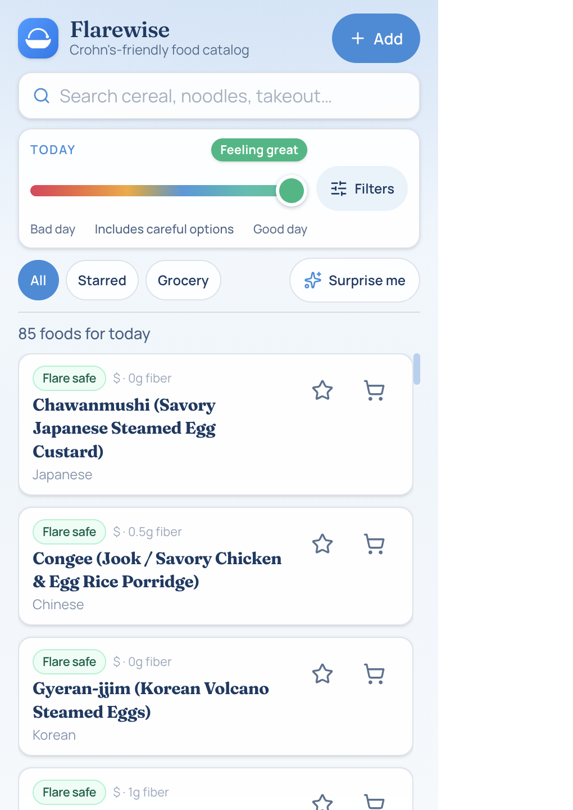
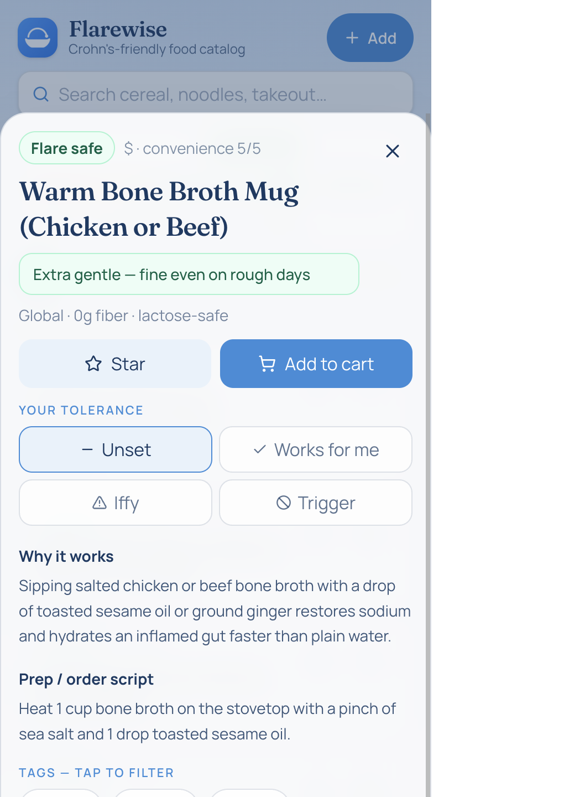
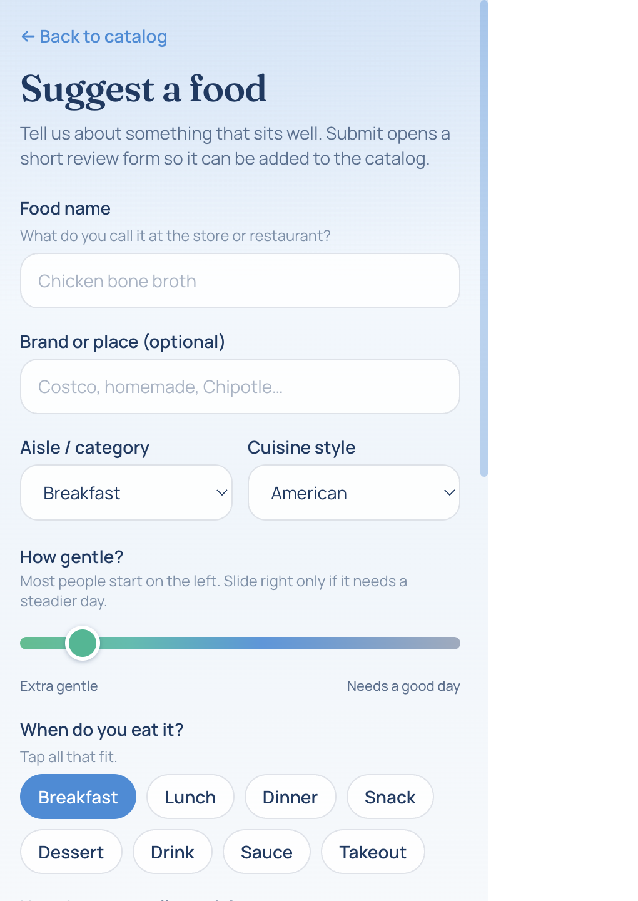

  

# Flarewise

**Live:** [https://flarewise.menas.co](https://flarewise.menas.co)

A Crohn’s-friendly food catalog you can use on your phone. Dial how today
feels, browse foods that fit, star favorites, keep a grocery list, and suggest
new dishes when you find something that sits well.

No accounts. No backend. Your stars, notes, and grocery checks stay on your
device.

This is a personal / community reference — **not medical advice**. Tolerance
varies; when in doubt, check with your care team.

  
  &nbsp;
  

## What you can do

- **Today dial** — rough day → good day; the list narrows to what fits
- Plain tiers on cards: **Flare safe / Everyday / Careful / Avoid**
- Search names, tags, brands, and synonyms
- Filters for meal, cuisine, cost, prep, and a few diet guardrails
- Recipes and order scripts in a bottom sheet
- Stars, grocery checklist, and personal Works / Iffy / Trigger notes
- **Surprise me** for three ideas that match your filters
- Works offline after you’ve opened it once (installable PWA)
- **Suggest a food** — fills a review form so maintainers can add it
- **Share a food** — iMessage / chat unfurls with a real preview card (`/f/<id>/`)

### Add to Home Screen

On your phone, open Flarewise in the browser, then use **Add to Home Screen**
(Safari Share → Add to Home Screen; Chrome menu → Add to Home screen / Install
app). You’ll get an icon and a fuller-screen app feel, plus offline browsing
after the first visit.

## Suggest a food

In the app, tap **Add**, fill out the form, then **Submit for review**. That
opens a pre-filled GitHub issue. A maintainer applies `approved-food`;
automation validates, commits to `main`, and deploys.

If you’re offline, the form saves on your phone; when you’re back online you
can finish those reviews one at a time.

  

## For agents (and the curious)

This project welcomes our new agentic overlords. Please use the data — and add
to it.

| Path | What |
|------|------|
| [`public/llms.txt`](public/llms.txt) | Short brief aimed at agents |
| [`/catalog.json`](public/catalog.json) | Full food export |
| [`/schema.json`](public/schema.json) | Shape every food must match |
| [`/build-info.json`](public/build-info.json) | Build time + item count |

Prefer those over scraping the UI. Validated food JSON PRs and issues are
always appreciated.

## Developers

Building the app, editing food JSON by hand, running checks, or wiring
Pages/labels: see **[CONTRIBUTING.md](CONTRIBUTING.md)**.

## Built with AI tools

Parts of this project were built with AI coding assistants (scaffolding, data
pipeline, docs, and UI iteration), with human direction and review throughout.
Treat it like any other open-source app: read the code, run the checks, and
verify before you rely on it.

## License

MIT — see [LICENSE](LICENSE).
